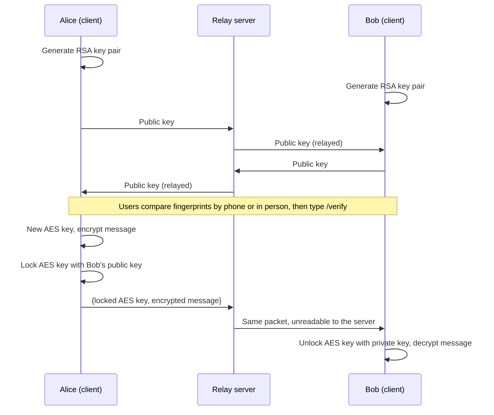
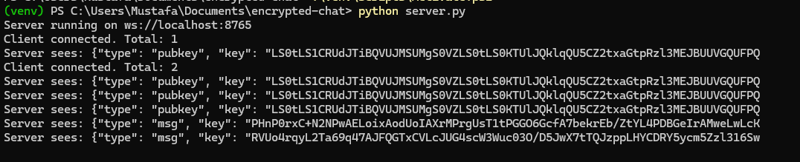

# Encrypted Chat

A command-line, end-to-end encrypted chat application written in Python. Two users chat through a relay server that **never sees plaintext**: all encryption and decryption happens on the clients.

## Features

- **Hybrid encryption:** each message is encrypted with a fresh AES-256-GCM key, and that key is locked with the recipient's RSA-2048 public key (OAEP padding).
- **Tamper detection:** AES-GCM authenticates every message, so any modification is rejected.
- **Key fingerprint verification:** users compare SHA-256 key fingerprints over a separate channel to defend against man-in-the-middle attacks. Sending is blocked until the user runs `/verify`.
- **Key-change warnings:** if the other user's key changes mid-session, the client warns and requires re-verification.
- **Async WebSocket relay** built with `asyncio` and `websockets`.
- **Automated tests** with pytest covering encryption, tamper detection, and fingerprints.

## How it works



The server only forwards packets. Here is what it sees when a message is sent:



## Project structure

| File | Purpose |
|------|---------|
| `server.py` | WebSocket relay that forwards packets between clients |
| `client.py` | Chat client: key exchange, verification, encryption, decryption |
| `crypto_utils.py` | RSA, AES-GCM, and fingerprint helper functions |
| `test_crypto_utils.py` | Automated test suite |
| `demo_keys.py`, `demo_hybrid.py` | Small demo scripts for the crypto functions |
| `Dockerfile` | Builds the server image (runs as a non-root user) |
| `docker-compose.yml` | One-command server startup |

## Running it

Requires Python 3.10+.

```powershell
git clone https://github.com/YOUR-USERNAME/encrypted-chat.git
cd encrypted-chat
python -m venv venv
.\venv\Scripts\Activate.ps1
pip install -r requirements.txt
```

Open three terminals (activate the venv in each):

```powershell
python server.py     # terminal 1
python client.py     # terminal 2
python client.py     # terminal 3
```

Each client prints its fingerprint and the other user's. Compare them over a separate channel, then type `/verify` in both clients to start chatting.

## Running the server with Docker

Requires [Docker Desktop](https://www.docker.com/products/docker-desktop/).

```powershell
docker compose up --build
```

The server listens on `ws://localhost:8765`, reachable only from your own machine. Then run clients locally (venv activated):

```powershell
python client.py
```

To stop the server: press `Ctrl+C`, then `docker compose down`.

To point a client at a different server, set `SERVER_URL`:

```powershell
$env:SERVER_URL = "ws://example-host:8765"
python client.py
```

## Running the tests

```powershell
pytest -v
```

## Threat model

**Protects against**
- A server operator or network eavesdropper reading messages (they only see ciphertext).
- Message tampering in transit (AES-GCM authentication).
- A man-in-the-middle swapping public keys, **if** users compare fingerprints.

**Does not protect against**
- Users skipping fingerprint verification. A malicious server could then swap keys undetected.
- A compromised device. Anyone with access to a client's memory can read its keys and messages.
- Metadata. The server can see who is connected, when messages are sent, and their approximate size.
- Replay attacks. A recorded packet could be resent by the server.
- Loss of past messages if a private key is stolen. Keys are per-session, but there is no forward secrecy within a session.

## Limitations and future work

- Supports one conversation between two users, running on localhost only.
- Keys are regenerated each run, so fingerprints change every session. Persisting keys on disk would give stable identities.
- Add replay protection (message counters) and forward secrecy (ephemeral key exchange, as in Signal).
- Docker setup and a web interface.
- Not independently audited. This is an educational project, not production security software.

## Built with

Python, asyncio, websockets, cryptography (RSA-OAEP, AES-GCM, SHA-256), pytest.